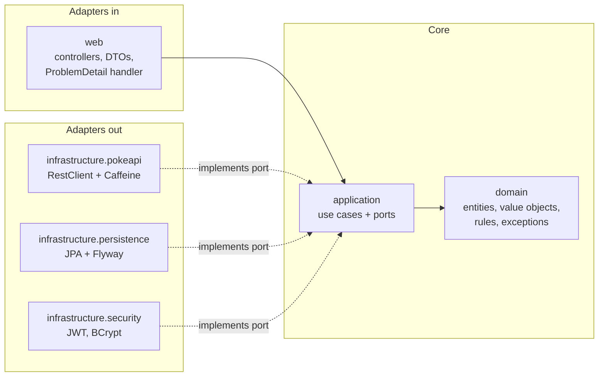

# Pokédex: Clean Architecture REST API + React

A Java 21 / Spring Boot 3.5 REST API that integrates with [PokeAPI](https://pokeapi.co/docs/v2), replicates Pokémon
into a local relational database, and lets authenticated users enrich them with proprietary fields. A responsive
React frontend uses every feature.

| | |
|---|---|
| **Backend** | Java 21, Spring Boot 3.5, Spring Security (JWT resource server), Spring Data JPA, Flyway, Caffeine, springdoc-openapi |
| **Database** | PostgreSQL 17 (Docker) · H2 in PostgreSQL mode (local runs and tests) |
| **Frontend** | React 19, TypeScript, Vite, TanStack Query, React Router, Tailwind CSS |
| **Tests** | JUnit 5, Mockito, AssertJ, MockMvc, `@DataJpaTest`, MockRestServiceServer · Vitest, Testing Library |

---

## Quick start

### Option A: Docker Compose (app + PostgreSQL)

```bash
docker compose up --build
```

Open <http://localhost:8080>. The single image serves both the React app and the API.

### Option B: single container, in-memory database

```bash
docker build -t pokedex .
docker run -p 8080:8080 pokedex
```

### Option C: local development

Prerequisites: JDK 21 and Node 20+. Maven is not needed; the wrapper is included.

```bash
# terminal 1: API on :8080 (in-memory H2, seeded)
cd backend
./mvnw spring-boot:run        # Windows: mvnw.cmd spring-boot:run

# terminal 2: frontend on :5173, proxies /api to :8080
cd frontend
npm install
npm run dev
```

Open <http://localhost:5173>.

### Demo data

The database is pre-populated on startup:

| Username | Password | Role | Can do |
|---|---|---|---|
| `demo` | `Demo1234` | USER | browse, sync, edit and refresh local Pokémon |
| `admin` | `Admin1234` | ADMIN | everything above, plus delete |

The local Pokédex is seeded (Flyway `V3`) with Bulbasaur, Charmander, Squirtle, Pikachu and Eevee. Each entry includes
proprietary fields: a Japanese name, a region, tags and notes.

**Useful URLs:**
- API docs (Swagger UI): <http://localhost:8080/swagger-ui.html>
- Health check: <http://localhost:8080/actuator/health>

---

## User stories → implementation

| Story | Frontend | API | Notes |
|---|---|---|---|
| **US01** Paginated list showing sprite, category, weight and abilities | Catalog (`/`) | `GET /api/pokemon?page=&size=` | PokeAPI's list endpoint returns names only, so each entry is enriched (pokemon + species) concurrently on virtual threads. Every PokeAPI response is cached with Caffeine: a cold page takes about 5 s, a cached page about 20 ms. |
| **US02** Detail view with image, stats, description and evolution chain | `/pokemon/:idOrName` | `GET /api/pokemon/{idOrName}` | Combines `pokemon`, `pokemon-species` and `evolution-chain`. Branching chains (e.g. Eevee) are returned as a tree, with human-readable triggers ("Use thunder stone", "Level 16"). |
| **US03** Replicate into a local relational store, with proprietary fields | "Add to my Pokédex" button, *My Pokédex* | `POST /api/local-pokemon`, `POST /api/local-pokemon/{id}/refresh` | Proprietary fields: `localizedName`, `region`, `tags`, `notes`. A refresh re-pulls the upstream data and keeps the proprietary fields. |
| **US04** Update locally stored Pokémon with robust validation | Edit form | `PUT /api/local-pokemon/{id}` | 400 for malformed or invalid payloads (with per-field errors), 404 for unknown records, 409 for a stale `version` (optimistic locking). |
| Users, authentication, protected routes | Login / Sign up | `POST /api/auth/register`, `POST /api/auth/login`, `GET /api/auth/me` | Stateless JWT. Catalog routes are public; the local Pokédex requires login; delete requires ADMIN. |

---

## Architecture

The backend follows **Clean Architecture**: dependencies point inwards, and the inner layers know nothing about Spring,
HTTP, JPA or PokeAPI.



```text
backend/src/main/java/com/pokedex
├── domain/            # pure Java: LocalPokemon aggregate, CustomFields, PageQuery, Credentials, exceptions
├── application/       # use cases (one class per action) + ports: PokemonCatalog, LocalPokemonRepository, ...
│   ├── catalog/       #   US01, US02
│   ├── localpokemon/  #   US03, US04
│   ├── auth/          #   register, login, current user
│   └── port/          #   interfaces implemented by infrastructure
├── infrastructure/    # framework code behind the ports
│   ├── pokeapi/       #   HTTP client, JSON models, mapper, catalog adapter
│   ├── persistence/   #   JPA entities (separate from domain), repository adapters
│   ├── security/      #   SecurityFilterChain, JWT issuer, BCrypt hasher, 401/403 handlers
│   └── config/        #   composition root (UseCaseConfig), demo user seeder
└── web/               # REST controllers, request/response records, global exception handler
```

### Key design decisions

- **Framework-free core.** Use cases are plain classes wired in `UseCaseConfig`. They are unit-tested with Mockito and
  no Spring context.
- **Always-valid domain objects.** `CustomFields`, `PageQuery`, `PokemonIdentifier` and `Credentials` validate and
  normalize in their constructors and report every field error at once. The business rules live in one place,
  independent of the API layer and the database.
- **Separate persistence models.** JPA entities never leave the persistence adapter, so lazy loading, mutable
  collections and annotations do not leak into business logic or JSON responses.
- **Optimistic concurrency.** Each record carries a `version`. A stale update is rejected by the domain (409) and, as a
  backstop, by JPA `@Version` for races between the read and the write.
- **Consistent errors.** Every error is an RFC 9457 `ProblemDetail`, including the 401 and 403 responses produced by
  the security filter chain. Unexpected exceptions are logged and returned as a generic 500 without internal details.
- **Caching.** PokeAPI data is effectively static, so responses are cached for 12 hours (max 2,000 entries). Per-call
  caching lets the list and detail views share entries. `GET /actuator/caches` (authenticated) lists the caches.
- **Resilience.** Connect and read timeouts are set. PokeAPI 404 becomes our 404; other upstream failures become 502.
- **Security.**
  - Passwords are hashed with BCrypt.
  - Login errors never reveal whether a username exists.
  - The JWT secret must be at least 32 bytes and is checked at startup.
  - Input identifiers are allow-listed before they reach PokeAPI.
  - User search terms are escaped before being used in `LIKE` queries.

### Data model

`app_user (id PK, username UNIQUE, password_hash, role, created_at)`

`local_pokemon (id PK = Pokédex number, name UNIQUE, category, height, weight, sprite_url, artwork_url, description,
localized_name, region, notes, synced_at, updated_at, version)` with the child tables `local_pokemon_type`,
`local_pokemon_ability`, `local_pokemon_stat` and `local_pokemon_tag`, all ordered and cascade-deleted.

---

## API reference

All responses are JSON. Paginated endpoints return
`{ content, page, size, totalElements, totalPages }`, with zero-based `page` and `size` between 1 and 100.

| Method | Path | Auth | Success | Errors |
|---|---|---|---|---|
| GET | `/api/pokemon?page&size` | public | 200 | 400, 502 |
| GET | `/api/pokemon/{idOrName}` | public | 200 | 400, 404, 502 |
| GET | `/api/local-pokemon?page&size&search` | user | 200 | 400, 401 |
| GET | `/api/local-pokemon/{id}` | user | 200 | 400, 401, 404 |
| POST | `/api/local-pokemon` `{ "idOrName": "pikachu" }` | user | 201 + `Location` | 400, 401, 404, 409, 502 |
| POST | `/api/local-pokemon/{id}/refresh` | user | 200 | 401, 404, 502 |
| PUT | `/api/local-pokemon/{id}` `{ localizedName, region, tags[], notes, version }` | user | 200 | 400, 401, 404, 409 |
| DELETE | `/api/local-pokemon/{id}` | admin | 204 | 401, 403, 404 |
| POST | `/api/auth/register` `{ username, password }` | public | 201 | 400, 409 |
| POST | `/api/auth/login` `{ username, password }` | public | 200 `{ accessToken, expiresAt, user }` | 400, 401 |
| GET | `/api/auth/me` | user | 200 | 401 |

Example error response:

```json
{
  "type": "about:blank",
  "title": "Validation failed",
  "status": 400,
  "detail": "One or more fields are invalid",
  "instance": "/api/local-pokemon/25",
  "errors": {
    "notes": "must be at most 500 characters",
    "tags": "each tag must be 1-30 lowercase letters, digits or hyphens"
  }
}
```

### Validation rules (US04)

| Field | Rule |
|---|---|
| `localizedName` | optional, at most 100 characters (trimmed; blank becomes null) |
| `region` | optional, at most 50 characters |
| `tags` | at most 10; each 1–30 characters of `[a-z0-9-]`; normalized to lowercase and de-duplicated |
| `notes` | optional, at most 500 characters |
| `version` | optional; when sent it must match the stored version, otherwise 409 |
| path `id` | must be a positive integer (400 otherwise) |
| `username` | 3–30 characters of `[a-z0-9_]`, case-insensitive |
| `password` | 8–72 characters, with at least one letter and one digit |

---

## Testing

```bash
cd backend && ./mvnw test     # 135 tests; JaCoCo report at backend/target/site/jacoco/index.html
cd frontend && npm test       # 22 tests
cd frontend && npm run lint   # ESLint (typescript-eslint, react-hooks)
```

Backend line coverage (JaCoCo):

| Layer | Line coverage |
|---|---|
| domain | 99% |
| application | 100% (100% of branches) |
| infrastructure | 99% |
| web | 96% |
| **Overall** | **98%** |

| Level | What is covered |
|---|---|
| Domain unit tests | every validation rule and boundary, normalization, version checks, refresh semantics |
| Use-case unit tests (Mockito) | happy paths and every failure path (400/404/409), plus the order of checks |
| PokeAPI adapter | recorded PokeAPI JSON fixtures served by `MockRestServiceServer`: mapping, 404 → empty, 5xx → `ExternalServiceException` |
| Persistence (`@DataJpaTest`) | real Flyway migrations and seed data, search, `LIKE` escaping, optimistic locking, unique constraints |
| Web slices (`@WebMvcTest`) | real security rules: 401/403, status codes, validation and malformed-JSON errors, response shape |
| End-to-end (`@SpringBootTest`) | register → login → sync → update → stale update (409) → user delete (403) → admin delete |
| Frontend (Vitest) | HTTP client error handling, client-side validation, pagination, evolution tree, login and registration flows |

Development was test-first by layer: domain rules and use cases were specified as tests before their
implementation, then the adapters were driven by slice tests.

---

## Frontend

```text
frontend/src
├── api/          # fetch wrapper (ApiError from ProblemDetail), typed endpoints, TanStack Query hooks
├── auth/         # AuthProvider (session in localStorage, auto-logout on expiry or 401), RequireAuth
├── components/   # Layout, PokemonCard, StatBars, EvolutionTree, Pagination, Sprite, feedback states
├── lib/          # formatting and client-side validation mirroring the backend rules
└── pages/        # Catalog, PokemonDetail, MyPokedex, EditLocalPokemon, Auth, NotFound
```

**State management:**
- **Server state** lives in TanStack Query: caching, request cancellation, previous-page placeholders and targeted
  invalidation after mutations.
- **UI state that should survive reloads** (page, page size, search) lives in the URL.
- **Session** lives in a small auth context.

**UX:**
- responsive grid from 1 to 4 columns;
- skeleton loaders;
- debounced search;
- inline delete confirmation;
- per-field server errors;
- a conflict banner with "Reload latest" when someone else saved first.

**Console:** a headless Chromium walkthrough of every user story found no browser console warnings or errors.

---

## Configuration

| Variable | Default | Purpose |
|---|---|---|
| `DB_URL` | in-memory H2 | JDBC URL (`jdbc:postgresql://db:5432/pokedex` in Compose) |
| `DB_USERNAME` / `DB_PASSWORD` | `sa` / empty | database credentials |
| `JWT_SECRET` | development value | HS256 signing key, at least 32 bytes; **override outside local development** |
| `CORS_ALLOWED_ORIGINS` | `http://localhost:5173` | only needed when the frontend runs on another origin without the dev proxy |
| `POKEAPI_BASE_URL` | `https://pokeapi.co/api/v2` | upstream API |
| `SEED_DEMO_USERS` | `true` | create the demo accounts on startup |

---

## Trade-offs and next steps

- **Token storage.** The JWT is stored in `localStorage` for simplicity. An httpOnly cookie with CSRF protection would
  resist XSS better.
- **Cache scope.** The cache is in-process. Running several instances would need Redis.
- **Upstream resilience.** Retries and a circuit breaker (Resilience4j) for PokeAPI would add resilience beyond the
  current timeouts.
- **Transaction boundaries.** Use cases are not wrapped in a transaction (they stay framework-free). Consistency
  comes from optimistic locking; a transactional decorator could be added in the composition root.
- **Testing and CI.** Next steps would be Testcontainers for PostgreSQL in CI, contract tests against the OpenAPI
  spec, and Playwright end-to-end tests in the pipeline.

## GenAI usage

See [docs/GENAI.md](docs/GENAI.md). It contains the prompt for the task-management exercise, a sample of the output,
how it was validated and corrected, and how AI was used in this repository.
